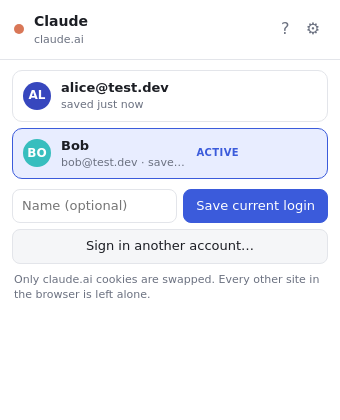

# Site Account Switcher

A Chrome extension for keeping several **Claude** and **ChatGPT** accounts (or accounts for any site you add) in one Chrome profile and switching between them in one click.

A switch replaces the cookies of **the current site only**. Every other site stays signed in.



## Install

1. Download `site-account-switcher.zip` from the [latest release](../../releases/latest) and unzip it.
2. Open `chrome://extensions` and turn on **Developer mode**.
3. Click **Load unpacked** and choose the unzipped folder.

A how-to guide opens on first install. You can reopen it any time with the **?** button in the popup.

## Quick start

1. Sign in on claude.ai or chatgpt.com, click the extension icon, then click **Save current login**.
2. Click **Sign in another account…**, sign in to the next account, then click **Save current login** again.
3. Click any saved account to switch to it.

> Don't use the site's own **Log out** button for an account you want to keep. It ends the saved session on the server.

## How it works

| Site    | Cookie domains swapped           |
|---------|----------------------------------|
| Claude  | `claude.ai`                      |
| ChatGPT | `chatgpt.com`, `auth.openai.com` |
| Custom  | whatever you add                 |

On switch, the extension:

1. Saves the current session into the active profile. It skips this if the signed-in email doesn't match the profile.
2. Clears the site's cookies, IndexedDB, cache and service workers. Cloudflare cookies are kept.
3. Restores the target profile's cookies and localStorage.
4. Reloads the site's tabs.

## Limits

- One account per site at a time, across all tabs. For two accounts side by side, use an Incognito window or another Chrome profile.
- Profiles are stored unencrypted in `chrome.storage.local`. Treat exported backups like passwords.
- The extension sends no data anywhere. Its only network request is an email lookup from the site's own tab to that same site.

## Development

```bash
npm install
npm test           # unit tests
npm run test:e2e   # real Chrome + local mock of claude.ai / chatgpt.com
npm run zip        # dist/site-account-switcher.zip
```
